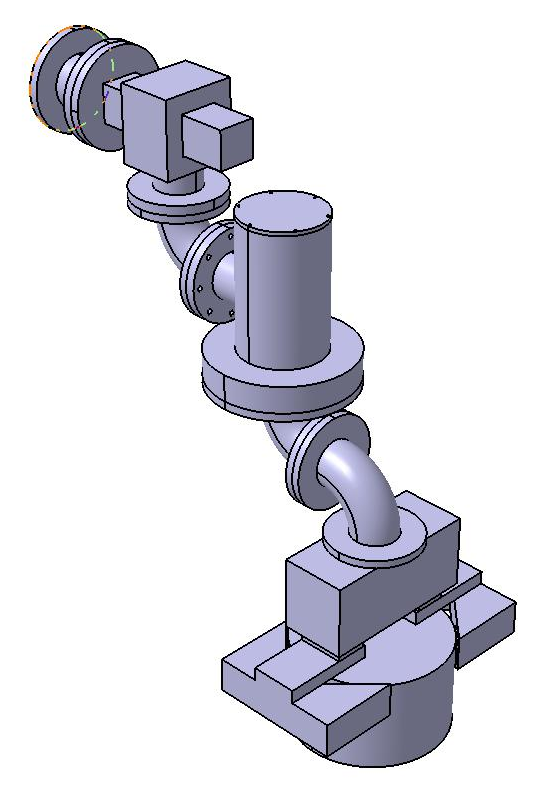
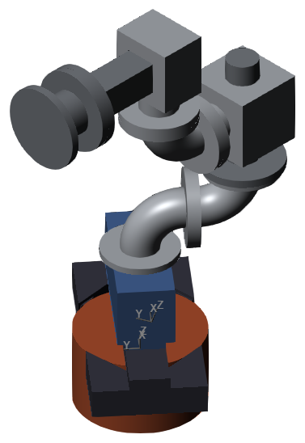
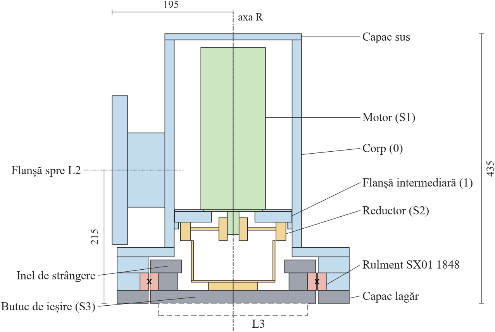
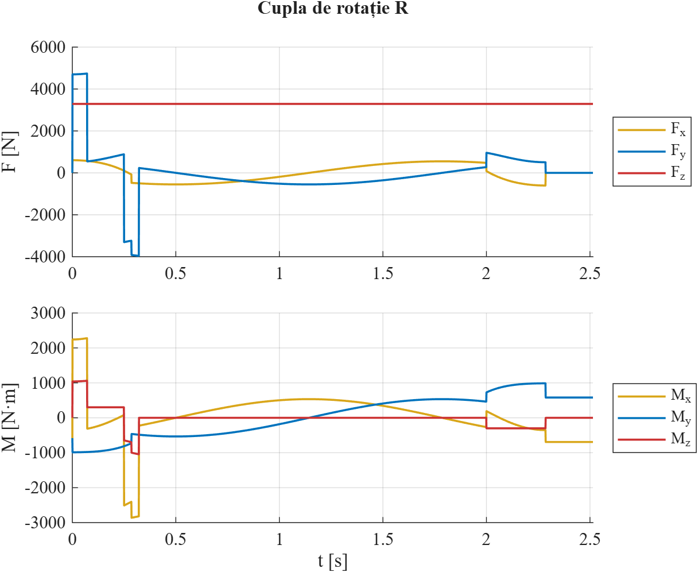

***English** · [Română](README.ro.md)*

# Industrial Robot Design – Wall-Mounted T–R Manipulator

Design of a fixed industrial robot with a translation module (T) and a rotation module (R) that handles a 237 kg steel cylinder. University project for the *Robot Design* course (*Proiectarea Roboților*), Transilvania University of Brașov, 2026.

  
  &nbsp;&nbsp;
  

## Task

- Kinematic structure **B(H) – T(HH) – R(VV) – P(V)**: wall-mounted base, horizontal translation, vertical rotation axis, vertical gripper.
- Handled object: steel cylinder, R = 200 mm, H = 240 mm (237 kg).
- Translation module T: stroke 225 mm, vmax = 0.9 m/s, amax = 12.5 m/s².
- Rotation module R: φ = 280°, ωmax = 140 °/s, εmax = 490 °/s².

## Work completed (stages I–III)

1. Functional and structural scheme, joint coordinate systems and workspace.
2. Gripping analysis (friction gripping with V-jaws, μ = 0.3) and gripper selection: **SCHUNK PGN-plus-P 380-2-AS-K** (pneumatic, 26.1 kN gripping force at 6 bar); design of the V-jaws.
3. 3D model, version 0, in **CATIA V5**: translation and rotation modules, base, 90° connecting elements, gripper, jaws and object; assembly by constraints and clash analysis (no interferences).
4. Inertial parameters about the rotation axis.
5. Dynamic model in **MATLAB / Simulink – Simscape Multibody (SimMechanics)**, built from the CATIA parts: trapezoidal motion laws, joint forces and torques, validation against CATIA and hand calculations.
6. Detailed design of the rotation module R: load cycle from the simulation, harmonic reducer **HDUC 50, i = 120**, servomotor **Festo EMMT-AS-100-M** with brake, crossed roller bearing **INA SX01 1848**, bolted joints; 3D model version 1 in CATIA V5 and updated dynamic model; all components re-checked with the version 1 loads.

## Key results

| Quantity | Ver. 0 | Ver. 1 |
|---|---|---|
| Total mass of the robot | 473.4 kg | 483.1 kg |
| Distance from the R axis to the gripper axis, LE | 300 mm | 300 mm |
| Moment of inertia about the R axis, JR | 35.04 kg·m² | 35.16 kg·m² |
| Maximum driving force, joint T * | 5528 N | 5649 N |
| Maximum driving torque, joint R * | 1059 N·m | 1060 N·m |
| Mass / inertia deviation, Simscape vs. CATIA | < 0.05 % | < 0.05 % |

\* simultaneous motion of both joints (worst case); with a single joint moving, ver. 1: 5104 N = m·a and 300.6 N·m = JR·ε.

Rotation module checks (ver. 1 loads):

| Component | Criterion | Value | Limit |
|---|---|---|---|
| Reducer HDUC 50-120 | peak torque | 1060 N·m | 1080 N·m |
| Reducer HDUC 50-120 | estimated life | 25 700 h | 10 000 h required |
| Motor EMMT-AS-100-M | peak torque | 14.1 N·m | 22.4 N·m |
| Motor EMMT-AS-100-M | RMS torque | 3.25 N·m | 6.3 N·m |
| Bearing SX01 1848 | static safety factor | 11.17 | ≥ 7 |
| Bearing SX01 1848 | life | 1 330 000 h | 10 000 h required |

The report also lists the requirements this solution does not fully meet: efficiency of about 0.72 (0.9 required) and motor operation up to about 70 °C ambient (90 °C required).

  

  

## Repository structure

| Path | Content |
|---|---|
| [`Ghid.10.1 Memoriu tehnic PrRo Stefan Horia.pdf`](Ghid.10.1%20Memoriu%20tehnic%20PrRo%20Stefan%20Horia.pdf) (`.docx`) | technical report (in Romanian) |
| `schema_functionla.jpg` | functional scheme of the robot |
| `CATIA/` | parts (`.CATPart`) and assemblies (`.CATProduct`); main assemblies: `Robot_v1.CATProduct` (current), `Robot_v0.CATProduct`; rotation module: `Modul_R1.CATProduct` |
| `CATIA/STEP/` | STEP export of all parts and assemblies (opens in any CAD software) |
| `CATIA/imagini/` | images of the parts and of the robot |
| `MATLAB/robot_v0_sim.slx` | Simscape Multibody model (uses the motion-law function `lege_trapez.m`) |
| `MATLAB/imagini/` | model diagram, motion laws, joint forces and torques, Mechanics Explorer view |
| `MATLAB/ver1/robot_v1_sim.slx` | Simscape Multibody model, version 1 (with its own copy of `lege_trapez.m`) |
| `MATLAB/ver1/imagini/` | model diagram, joint forces and torques, rotation module section, block and load diagrams |

## Tools

CATIA V5-6R2022 · MATLAB R2026b, Simulink, Simscape Multibody · Microsoft Word

## Opening the files

- **CATIA:** open `CATIA/Robot_v1.CATProduct`, or the STEP files in any CAD software.
- **MATLAB:** open `MATLAB/ver1/robot_v1_sim.slx` (or `MATLAB/robot_v0_sim.slx`) and press *Run* (requires Simscape Multibody). The 3D animation in Mechanics Explorer needs Java; in MATLAB R2026b, install the *MATLAB Support for OpenJDK* add-on. The *File Solid* blocks load the parts from the `CATIA` folder by absolute path; if the repository is cloned to another location, update the file paths in these blocks.

## Status

Work in progress – stages I–III of VI completed. Next: detailed design of the translation module (motor, transmission, guides), connecting elements, assembly drawing and detail drawings.

## Author

**Horia-Eusebiu Ștefan** – Transilvania University of Brașov.
Course coordinators: Prof. Gheorghe Mogan, Asst. Diana Buzdugan.
