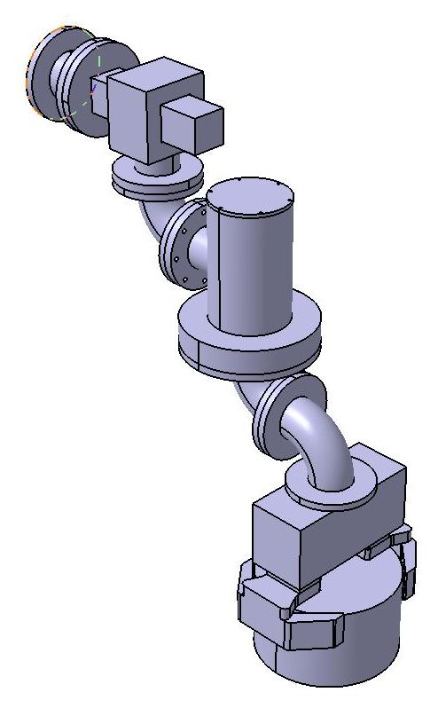
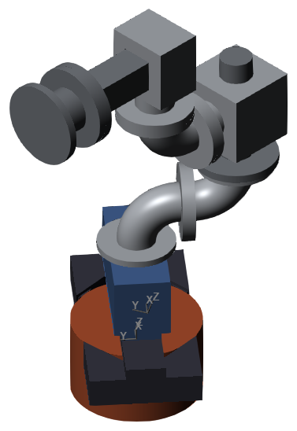
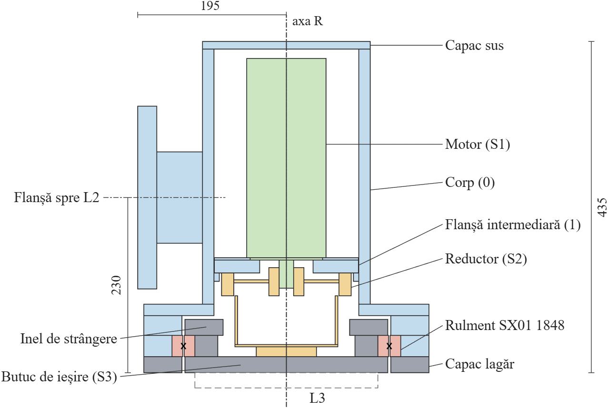
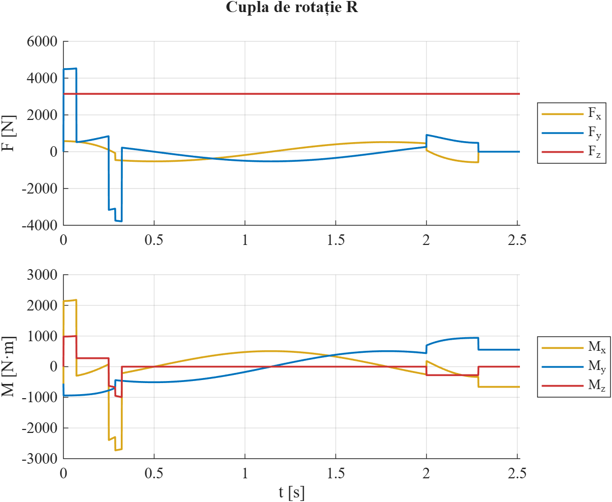

*[English](README.md) · **Română***

# Proiectarea unui robot industrial – manipulator T–R fixat pe perete

Proiectarea unui robot industrial fix, cu un modul de translație (T) și un modul de rotație (R), pentru manipularea unui cilindru din oțel de 237 kg. Proiect de an la disciplina *Proiectarea Roboților*, Universitatea Transilvania din Brașov, 2026.

  
  &nbsp;&nbsp;
  

## Tema

- Structura cinematică **B(H) – T(HH) – R(VV) – P(V)**: bază fixată pe perete, translație orizontală, axă de rotație verticală, prehensor vertical.
- Obiectul manipulat: cilindru din oțel, R = 200 mm, H = 240 mm (237 kg).
- Modulul de translație T: cursa 225 mm, vmax = 0,9 m/s, amax = 12,5 m/s².
- Modulul de rotație R: φ = 280°, ωmax = 140 °/s, εmax = 490 °/s².

## Ce s-a realizat (vizele I–III)

1. Schema funcțională și structurală, sistemele de coordonate ale cuplelor și spațiul de lucru.
2. Analiza prinderii (prindere prin frecare, cu bacuri în V, μ = 0,3) și alegerea prehensorului: **SCHUNK PGN-plus-P 380-2-AS-K** (pneumatic, forță de strângere 26,1 kN la 6 bar); proiectarea bacurilor în V.
3. Modelul 3D, versiunea 0, în **CATIA V5**: modulele de translație și de rotație, baza, elementele de legătură la 90°, prehensorul, bacurile și obiectul; asamblare prin constrângeri și analiza interferențelor (fără interferențe).
4. Parametrii inerțiali față de axa de rotație.
5. Modelul dinamic în **MATLAB / Simulink – Simscape Multibody (SimMechanics)**, construit din piesele CATIA: legi de mișcare trapezoidale, forțele și momentele din cuple, validare față de CATIA și de calculul analitic.
6. Proiectarea detaliată a modulului de rotație R: ciclul de încărcare din simulare, reductorul armonic **HDUC 50, i = 120**, servomotorul **Festo EMMT-AS-100-M** cu frână, rulmentul cu role încrucișate **INA SX01 1848**, legăturile cu șuruburi; modelul 3D versiunea 1 în CATIA V5 și modelul dinamic actualizat; toate componentele reverificate cu încărcările ver. 1. Bacuri în V îmbunătățite pentru ver. 1: 5,8 kg în loc de 13,2 kg, cu același V de 90°, aceleași garnituri și aceeași prindere pe prehensor.

## Rezultate principale

| Mărimea | Ver. 0 | Ver. 1 |
|---|---|---|
| Masa totală a robotului | 473,4 kg | 468,3 kg |
| Distanța dintre axa R și axa prehensorului, LE | 300 mm | 300 mm |
| Momentul de inerție față de axa R, JR | 35,04 kg·m² | 32,40 kg·m² |
| Forța maximă de acționare, cupla T * | 5528 N | 5438 N |
| Momentul maxim de acționare, cupla R * | 1059 N·m | 1000 N·m |
| Abaterea maselor / momentelor de inerție, Simscape față de CATIA | < 0,05 % | < 0,05 % |

\* mișcarea simultană a celor două cuple (cazul cel mai defavorabil); cu o singură cuplă în mișcare, la ver. 1: 4919 N = m·a și 277,0 N·m = JR·ε.

Verificările modulului de rotație (încărcări ver. 1):

| Componenta | Criteriul | Valoarea | Limita |
|---|---|---|---|
| Reductor HDUC 50-120 | moment de vârf | 1000 N·m | 1080 N·m |
| Reductor HDUC 50-120 | durată estimată | 30 000 ore | 10 000 ore cerute |
| Motor EMMT-AS-100-M | moment de vârf | 13,4 N·m | 22,4 N·m |
| Motor EMMT-AS-100-M | moment efectiv | 3,09 N·m | 6,3 N·m |
| Rulment SX01 1848 | siguranță statică | 11,70 | ≥ 7 |
| Rulment SX01 1848 | durată | 1 556 000 ore | 10 000 ore cerute |

Memoriul semnalează și cerințele pe care soluția nu le îndeplinește complet: randamentul de circa 0,72 (se cere 0,9) și funcționarea motorului până la circa 70 °C ambiant (se cer 90 °C).

  

  

## Structura depozitului

| Calea | Conținut |
|---|---|
| [`Ghid.10.1 Memoriu tehnic PrRo Stefan Horia.pdf`](Ghid.10.1%20Memoriu%20tehnic%20PrRo%20Stefan%20Horia.pdf) (`.docx`) | memoriul tehnic |
| `schema_functionla.jpg` | schema funcțională a robotului |
| `CATIA/` | piesele (`.CATPart`) și ansamblele (`.CATProduct`); ansamblele principale: `Robot_v1.CATProduct` (actual), `Robot_v0.CATProduct`; modulul de rotație: `Modul_R1.CATProduct` |
| `CATIA/STEP/` | exportul STEP al tuturor pieselor și ansamblelor (se deschide în orice program CAD) |
| `CATIA/imagini/` | imagini ale pieselor și ale robotului |
| `MATLAB/robot_v0_sim.slx` | modelul Simscape Multibody (folosește funcția legii de mișcare `lege_trapez.m`) |
| `MATLAB/imagini/` | schema modelului, legile de mișcare, forțele și momentele din cuple, vederea din Mechanics Explorer |
| `MATLAB/ver1/robot_v1_sim.slx` | modelul Simscape Multibody, versiunea 1 (cu propria copie a `lege_trapez.m`) |
| `MATLAB/ver1/imagini/` | schema modelului, forțele și momentele din cuple, secțiunea modulului de rotație, schema bloc și schemele de încărcare |

## Programe folosite

CATIA V5-6R2022 · MATLAB R2026b, Simulink, Simscape Multibody · Microsoft Word

## Deschiderea fișierelor

- **CATIA:** se deschide `CATIA/Robot_v1.CATProduct` sau fișierele STEP, în orice program CAD.
- **MATLAB:** se deschide `MATLAB/ver1/robot_v1_sim.slx` (sau `MATLAB/robot_v0_sim.slx`) și se apasă *Run* (necesită Simscape Multibody). Animația 3D din Mechanics Explorer are nevoie de Java; în MATLAB R2026b se instalează add-on-ul *MATLAB Support for OpenJDK*. Blocurile *File Solid* încarcă piesele din folderul `CATIA` prin cale absolută; dacă depozitul este copiat în alt loc, căile din aceste blocuri trebuie actualizate.

## Stadiul proiectului

În lucru – vizele I–III din VI sunt finalizate. Urmează: proiectarea detaliată a modulului de translație (motor, transmisie, ghidaje), elementele de legătură, desenul de ansamblu și desenele de execuție.

## Autor

**Horia-Eusebiu Ștefan** – Universitatea Transilvania din Brașov.
Coordonatori: Prof. univ. dr. ing. Gheorghe Mogan, Asist. drd. Diana Buzdugan.
